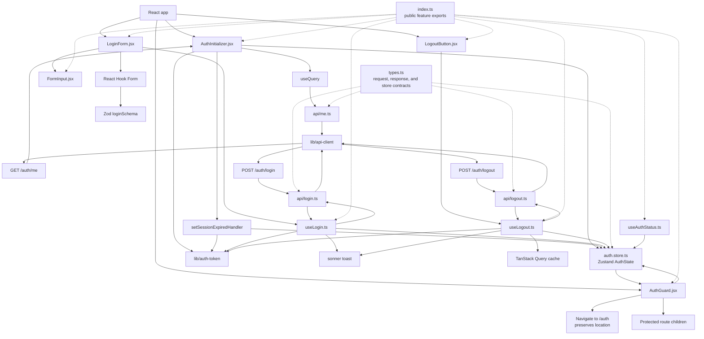

# Authentication feature

This feature owns the frontend authentication flow. Its public API is
centralized in [`index.ts`](./index.ts).

## Connection diagram

## Runtime flows

### Application startup and route protection

1. `AuthInitializer` starts with the store status set to `checking`.
2. Its TanStack Query calls `me`, which requests `GET /auth/me` through the
   shared API client. The client can refresh the access token using the
   HTTP-only refresh-token cookie before the request.
3. A successful response reads the current token from `tokenStore`, updates
   the Zustand store, and sets status to `authenticated`.
4. A failed response sets status to `unauthenticated`.
5. `AuthGuard` renders a loading state while checking, redirects unauthenticated
   users to `/auth`, or renders its protected children when authenticated.

### Login

`LoginForm` validates `username` and `password` with Zod through React Hook
Form. On submission it calls `useLogin`, which calls `login` and
`POST /auth/login`. On success, the returned access token is written to both
`tokenStore` and the Zustand store, status becomes `authenticated`, and a
success toast is shown. API field errors are mapped back to the form by
`applyFieldErrors`.

### Logout

`LogoutButton` calls `useLogout`, which calls `logout` and `POST /auth/logout`.
Whether the server request succeeds or fails, the hook clears the token,
clears the TanStack Query cache, and sets the Zustand status to
`unauthenticated`. It then displays the corresponding toast.

### Session expiry during an active session

`AuthInitializer` registers a callback with `setSessionExpiredHandler`.
When the API client cannot rotate the refresh token, that callback clears the
token and invokes the store's `logout` action, allowing `AuthGuard` to redirect
the user on the next render.

## File responsibilities

| File | Responsibility |
| --- | --- |
| [`types.ts`](./types.ts) | TypeScript contracts for auth requests, responses, and Zustand state. |
| [`store/auth.store.ts`](./store/auth.store.ts) | In-memory access token and `checking`/`authenticated`/`unauthenticated` state. |
| [`api/login.ts`](./api/login.ts) | Calls `POST /auth/login` and translates Axios failures into errors. |
| [`api/logout.ts`](./api/logout.ts) | Calls `POST /auth/logout` and translates Axios failures into errors. |
| [`api/me.ts`](./api/me.ts) | Calls `GET /auth/me` to validate or restore the current session. |
| [`hooks/useLogin.ts`](./hooks/useLogin.ts) | Login mutation, token/state updates, success toast, and form error mapping. |
| [`hooks/useLogout.ts`](./hooks/useLogout.ts) | Logout mutation and unconditional local cleanup. |
| [`hooks/useAuthStatus.ts`](./hooks/useAuthStatus.ts) | Read-only derived selectors for auth status and token. |
| [`components/LoginForm.jsx`](./components/LoginForm.jsx) | Validated username/password form and submit error display. |
| [`components/FormInput.jsx`](./components/FormInput.jsx) | Reusable React Hook Form controller around the shared input component. |
| [`components/LogoutButton.jsx`](./components/LogoutButton.jsx) | Button UI that triggers the logout mutation. |
| [`components/AuthInitializer.jsx`](./components/AuthInitializer.jsx) | Restores the session at app startup and registers session-expiry handling. |
| [`components/AuthGuard.jsx`](./components/AuthGuard.jsx) | Shows loading, redirects unauthenticated users, or renders protected content. |
| [`index.ts`](./index.ts) | Public barrel exports for components, hooks, API functions, the store, and types. |
