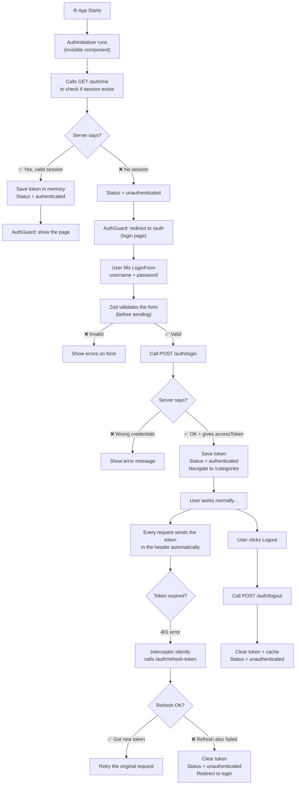

# 📚 React Auth & API — Full Learning Guide
> **For complete beginners. Simple English. Your real code.**

---

## 🧠 PART 1 — What do we want? What is the BIG picture?

Imagine you have a shop. The shop has a **back office** (admin panel) that only you can enter. To enter, you need to:

1. **Prove who you are** → You type your username + password (Login)
2. **Get a key** → The server gives you a secret key (called a **Token**)
3. **Show the key every time you open a door** → Every time you ask for data, you show that key
4. **If the key expires** → The app silently gets a new key (Refresh)
5. **When you leave** → You throw away the key (Logout)

That's exactly what this code does. Nothing more. Nothing less.

---

## 🗺️ PART 2 — Flow Map (what happens step by step)



---

## 🏗️ PART 3 — The Architecture (how files are organized)

Before we dive into each file, here is **why** we organize code this way:

> Think of it like a restaurant:
> - **`lib/`** = the kitchen equipment (tools everyone uses)
> - **`features/auth/api/`** = the waiters (they go talk to the server)
> - **`features/auth/store/`** = the whiteboard in the kitchen (shared memory)
> - **`features/auth/hooks/`** = the recipes (combine tools + waiters + whiteboard)
> - **`features/auth/components/`** = the actual dishes you serve to the user

```
src/
├── lib/                        ← Shared tools (everyone uses these)
│   ├── api-client.ts           ← The HTTP messenger (Axios)
│   ├── api-error.ts            ← Translates server errors to readable messages
│   ├── auth-token.ts           ← Tiny memory box for the token
│   └── query-client.ts         ← Settings for TanStack Query
│
└── features/auth/              ← Everything about authentication
    ├── types.ts                ← "Contracts" — what data looks like
    ├── store/auth.store.ts     ← Global memory (Zustand)
    ├── api/
    │   ├── login.ts            ← Sends POST /auth/login
    │   ├── logout.ts           ← Sends POST /auth/logout
    │   └── me.ts               ← Sends GET /auth/me
    ├── hooks/
    │   ├── useLogin.ts         ← Login logic + side effects
    │   ├── useLogout.ts        ← Logout logic + side effects
    │   └── useAuthStatus.ts    ← Read auth state anywhere
    ├── components/
    │   ├── LoginForm.jsx       ← The login form UI
    │   ├── FormInput.jsx       ← Reusable input field
    │   ├── LogoutButton.jsx    ← The logout button UI
    │   ├── AuthInitializer.jsx ← Restores session on app start
    │   └── AuthGuard.jsx       ← Protects pages from non-logged users
    └── index.ts                ← The "front door" — exports everything
```

---

## 📖 PART 4 — Step by Step, File by File

We will go in the **order the code was built**, starting from the foundation up to the UI.

---

### STEP 1 — `lib/auth-token.ts` — The Token Memory Box

**[auth-token.ts](file:///media/maya/A4E6D724E6D6F610/Maya/E-commerce/frontend/src/lib/auth-token.ts)**

```ts
let token: string | null = null;

export const tokenStore = {
  get: () => token,
  set: (newToken: string | null) => { token = newToken; },
};
```

**What is this?**

We created a **variable called `token`** that lives in memory (RAM). It's like a sticky note that holds your access token.

**Why not use `localStorage`?**
> `localStorage` is like writing your password on a piece of paper glued to your screen. Any malicious script on the page can steal it. Keeping the token **only in memory** means when the tab closes, it disappears. Much safer.

**What is `tokenStore`?**
It's just a simple **object** with two functions:
- `get()` → reads the token from memory
- `set(newToken)` → saves a new token (or `null` to clear it)

**Question you might have:** *"Why not just use a React state variable?"*
> Because `tokenStore` needs to be used **outside of React components** too — like in the Axios interceptor. React state only works inside components.

---

### STEP 2 — `lib/api-error.ts` — The Error Translator

**[api-error.ts](file:///media/maya/A4E6D724E6D6F610/Maya/E-commerce/frontend/src/lib/api-error.ts)**

**What is this?**

When the server says something went wrong, it can say it in many different formats. This file is a **translator** — it takes any server error and converts it into one standard format called `ApiError`.

**Key concepts:**

| Term | Simple definition |
|------|-----------------|
| `class ApiError extends Error` | We created our **own type of error**. `extends Error` means it IS an error, but with extra info (like `status` and `fieldErrors`) |
| `status: number \| null` | The HTTP status code (like 401 = unauthorized, 404 = not found, 500 = server crashed) |
| `fieldErrors` | A map of "which field has an error". Example: `{ username: "Too short", password: "Required" }` |
| `toApiError(error)` | A function that takes ANY error and always returns an `ApiError` |

**Why do we need this?**
> Without it, every file that calls the server would need its own code to understand errors. With it, we handle errors **once**, in one place, in a consistent way.

**Question you might have:** *"What is `instanceof`?"*
> It's like asking "is this thing a member of this club?". `error instanceof AxiosError` = "is this error specifically an Axios error?"

---

### STEP 3 — `lib/api-client.ts` — The HTTP Messenger

**[api-client.ts](file:///media/maya/A4E6D724E6D6F610/Maya/E-commerce/frontend/src/lib/api-client.ts)**

This is the **most important file in `lib/`**. Everything that talks to the server goes through here.

**What is Axios?**
> Axios is a third-party library (a tool made by other developers that we installed). Its job: make HTTP requests (GET, POST, etc.) much easier than the browser's built-in `fetch`. Think of it as a **trained messenger**.

```ts
export const apiClient = axios.create({
  baseURL: env.API_URL,       // like "http://localhost:3000/api"
  withCredentials: true,      // sends cookies automatically (needed for refresh token)
  headers: { 'Content-Type': 'application/json' },
});
```

We call `axios.create()` to make a **custom version of Axios** pre-configured with our server's URL.

**What is `withCredentials: true`?**
> Browsers normally don't send cookies to other domains for security. `withCredentials: true` tells the browser "yes, please send cookies to our server". We need this for the **refresh token cookie** (explained below).

---

#### 🔑 What are Access Token and Refresh Token?

| Token | What it is | Where stored | How long it lives |
|-------|-----------|-------------|------------------|
| **Access Token** | A short-lived pass that proves you're logged in | In memory (RAM) only | ~15 minutes |
| **Refresh Token** | A long-lived pass to get a NEW access token | In an HTTP-only cookie (the browser manages it, JS can't read it) | Days or weeks |

> **Why two tokens?** If someone steals your access token, it expires in 15 minutes — no big deal. The refresh token is in an `HttpOnly` cookie, which JavaScript can't access at all, so it's very hard to steal.

---

#### ⚙️ What is an Interceptor?

An interceptor is like a **checkpoint**. Every request and every response passes through it.

**Request Interceptor** (runs BEFORE every request goes out):
```ts
apiClient.interceptors.request.use((config) => {
  const token = tokenStore.get();
  if (token) config.headers.Authorization = `Bearer ${token}`;
  return config;
});
```
> Every time we make a request, this automatically adds the token to the header. Like a bouncer who stamps your hand before you enter every room — you don't have to do it manually each time.

**Response Interceptor** (runs AFTER every response comes back):
```ts
apiClient.interceptors.response.use(
  (res) => res,  // ✅ success: just pass it through
  async (error) => {
    // ❌ error handling here
    if (error.response?.status === 401 && !original._retry && !isAuthRoute) {
      // Token expired! Try to get a new one silently...
    }
  }
);
```

**What happens on a 401 error?**
1. A request fails with 401 (Unauthorized — token expired)
2. The interceptor catches it
3. It calls `/auth/refresh-token` to get a new access token (using the cookie)
4. It saves the new token
5. It **retries the original request** automatically
6. The user never even notices anything happened!

**Question you might have:** *"What is `_retry`?"*
> It's a flag we set to `true` after the first retry attempt. Without it, if the refresh also returns 401, we'd retry infinitely forever and crash the app.

**Question you might have:** *"What is `single-flight` / `refreshPromise`?"*
> Imagine 5 requests fail at the same time with 401. Without single-flight, we'd call `/refresh-token` 5 times! With it, all 5 requests **share the same single refresh call**. The `??=` operator means "if `refreshPromise` is null, assign it; otherwise keep the existing one".

---

### STEP 4 — `lib/query-client.ts` — TanStack Query Settings

**[query-client.ts](file:///media/maya/A4E6D724E6D6F610/Maya/E-commerce/frontend/src/lib/query-client.ts)**

**What is TanStack Query (React Query)?**
> It's a library that manages **server data** for you. Without it, every time you fetch data, you'd manually write loading states, error states, caching, re-fetching... With TanStack Query, all that is automatic.

```ts
export const queryClient = new QueryClient({
  defaultOptions: {
    queries: {
      staleTime: 30_000,          // Data is "fresh" for 30 seconds, don't re-fetch
      refetchOnWindowFocus: false, // Don't re-fetch when you switch browser tabs
      retry: (failureCount, error) => {
        if (status < 500) return false; // 4xx errors won't fix themselves, don't retry
        return failureCount < 2;        // 5xx (server crash) → try up to 2 more times
      },
    },
  },
});
```

**Key terms:**

| Term | Simple definition |
|------|-----------------|
| `staleTime` | How long data is considered "fresh". After this, it will re-fetch in the background |
| `refetchOnWindowFocus` | Should the app re-fetch data every time you alt-tab back to it? We say no |
| `retry` | If a request fails, should we try again? For 4xx errors (like 401 wrong password), no — the answer won't change. For 5xx (server down temporarily), try again up to 2 times |

---

### STEP 5 — `features/auth/types.ts` — The Contracts

**[types.ts](file:///media/maya/A4E6D724E6D6F610/Maya/E-commerce/frontend/src/features/auth/types.ts)**

**What is this?**

TypeScript lets us define the **shape of data** in advance. These are called `interface`s — they're like contracts that say "this data MUST have these exact fields".

```ts
export interface LoginRequest {
  username: string;
  password: string;
}
```
> When we call login, we MUST send `username` and `password`. TypeScript will give us an error if we forget one.

```ts
export interface LoginResponse {
  success: boolean;
  accessToken: string;
}
```
> The server WILL respond with these two fields. We can safely access `response.accessToken` knowing it exists.

**Why define types?**
> Without types, you might accidentally write `response.acces_token` (typo) and get a confusing bug. With types, TypeScript catches it immediately and says "hey, that field doesn't exist".

**What is `AuthState`?**
```ts
export interface AuthState {
  accessToken: string | null;
  status: "checking" | "authenticated" | "unauthenticated";
  setAccessToken: (token: string | null) => void;
  setStatus: (status: AuthState["status"]) => void;
  logout: () => void;
}
```
> This describes the shape of our **global auth store** (explained in next step). Three possible statuses:
> - `"checking"` → app just started, we don't know yet if user is logged in
> - `"authenticated"` → user is logged in
> - `"unauthenticated"` → user is NOT logged in

---

### STEP 6 — `store/auth.store.ts` — The Global Memory (Zustand)

**[auth.store.ts](file:///media/maya/A4E6D724E6D6F610/Maya/E-commerce/frontend/src/features/auth/store/auth.store.ts)**

**What is Zustand?**
> Zustand is a **global state manager**. Imagine a whiteboard in the middle of the office. Any component in the app can read from it or write to it. Without Zustand, passing data between components that are far apart is very painful.

```ts
const useAuthStore = create<AuthState>((set) => ({
  accessToken: null,     // starts empty
  status: "checking",   // starts as "checking"

  setAccessToken: (token) => set({ accessToken: token }),
  setStatus: (status) => set({ status }),
  logout: () => set({ accessToken: null, status: "unauthenticated" }),
}));
```

**How to use it in a component:**
```ts
// Read a value
const status = useAuthStore((s) => s.status);

// Get a function to change a value
const setStatus = useAuthStore((s) => s.setStatus);
setStatus("authenticated");
```

**Question you might have:** *"Why do we write `(s) => s.status` instead of just getting the whole store?"*
> Performance! If you get the whole store, your component re-renders every time ANYTHING in the store changes. By selecting only `status`, your component only re-renders when `status` specifically changes.

**Question you might have:** *"What is `set`?"*
> `set` is a function provided by Zustand. You call it with the new values, and it **merges** them into the store. Like `Object.assign`.

---

### STEP 7 — `api/login.ts` — The Login Waiter

**[login.ts](file:///media/maya/A4E6D724E6D6F610/Maya/E-commerce/frontend/src/features/auth/api/login.ts)**

```ts
export const login = async (data: LoginRequest): Promise<LoginResponse> => {
  try {
    const response = await apiClient.post<LoginResponse>("/auth/login", data);
    return response.data;
  } catch (error) {
    // translate error and throw
  }
}
```

**What does this do?**
> It sends a POST request to `/auth/login` with the user's credentials. That's it. It's intentionally simple.

**Key terms:**

| Term | Simple definition |
|------|-----------------|
| `async` | This function does something that takes time (network request). It doesn't block the app while waiting |
| `await` | "Wait here until this promise finishes, then continue" |
| `Promise<LoginResponse>` | This function returns a promise that, when resolved, gives back a `LoginResponse` |
| `apiClient.post<LoginResponse>("/auth/login", data)` | Send a POST request to `/auth/login`, send `data` as the body, expect a `LoginResponse` back |

**Question you might have:** *"What is `async/await`?"*
> When you order food at a restaurant, you don't stand at the counter frozen waiting. You go sit down and do other things. `async/await` is the same — JavaScript doesn't freeze waiting for the server. It continues doing other things and comes back when the response arrives.

---

### STEP 8 — `api/logout.ts` and `api/me.ts`

**[logout.ts](file:///media/maya/A4E6D724E6D6F610/Maya/E-commerce/frontend/src/features/auth/api/logout.ts)** — Same pattern as login, but sends a POST to `/auth/logout`.

**[me.ts](file:///media/maya/A4E6D724E6D6F610/Maya/E-commerce/frontend/src/features/auth/api/me.ts)** — Notice something different:

```ts
export const me = async (): Promise<MeResponse> => {
  // NO try/catch intentionally!
  const response = await apiClient.get<MeResponse>("/auth/me");
  return response.data;
};
```

**Why no try/catch here?**
> Because we WANT errors to bubble up to the interceptor! If `/auth/me` returns 401, the interceptor catches it, silently refreshes the token, and retries. If we caught the error here, the interceptor would never get a chance to do its magic.

---

### STEP 9 — `hooks/useLogin.ts` — The Login Recipe

**[useLogin.ts](file:///media/maya/A4E6D724E6D6F610/Maya/E-commerce/frontend/src/features/auth/hooks/useLogin.ts)**

**What is a Hook?**
> A Hook is a special React function (always starts with `use`). It lets you "hook into" React features like state, effects, etc. from inside a component. Hooks are reusable logic.

**What is `useMutation` (from TanStack Query)?**
> `useMutation` is for actions that **change something** on the server (POST, PUT, DELETE). It gives you:
> - `mutate(data)` — a function to call when you want to trigger the action
> - `isPending` — `true` while the request is running
> - `onSuccess` — callback when it works
> - `onError` — callback when it fails

```ts
const mutation = useMutation({
  mutationFn: (data: LoginRequest) => login(data),  // calls our api/login.ts

  onSuccess: ({ accessToken }) => {
    tokenStore.set(accessToken);       // save token in memory
    setAccessToken(accessToken);       // save token in Zustand store
    setStatus("authenticated");        // mark user as logged in
    toast.success("Welcome back!");    // show a success notification
    navigate("/categories", { replace: true }); // go to the dashboard
  },
});
```

**What is `toast`?**
> Sonner is a library that shows those little notification popups in the corner. `toast.success("Welcome back!")` shows a green popup that disappears after a few seconds.

**What is `navigate`?**
> From React Router. `navigate("/categories")` changes the URL and shows a different page — without refreshing the browser.

**What is `applyFieldErrors`?**
```ts
function applyFieldErrors(error, setError) {
  if (error instanceof ApiError) {
    // If server says "username: too short", map it back to the form field
    Object.entries(fieldErrors).forEach(([field, message]) => {
      setError(field, { message });
    });
  }
}
```
> If the server says "username is wrong" or "password is wrong", this function takes that info and **puts the error message directly on the form field** next to the input, not just as a generic message.

---

### STEP 10 — `hooks/useLogout.ts`

**[useLogout.ts](file:///media/maya/A4E6D724E6D6F610/Maya/E-commerce/frontend/src/features/auth/hooks/useLogout.ts)**

```ts
const clearLocal = () => {
  tokenStore.set(null);     // wipe token from memory
  queryClient.clear();      // wipe ALL cached server data
  logoutStore();            // set status to "unauthenticated"
};

const { mutate, isPending } = useMutation({
  mutationFn: logout,
  onSuccess: () => { clearLocal(); toast.success("Logged out."); },
  onError:   () => { clearLocal(); toast.error("Logout failed. Signed out locally."); },
});
```

**Why do we clear local state even on error?**
> Because if the server call fails (network issue), the user is still stuck on the app thinking they're logged in. We always clear local state so the user is never stuck. Better to log them out locally even if the server didn't confirm it.

**What is `queryClient.clear()`?**
> When you log out, you should not keep another user's data in memory. `queryClient.clear()` wipes **all cached server responses**. Next person who logs in starts fresh.

---

### STEP 11 — `hooks/useAuthStatus.ts`

**[useAuthStatus.ts](file:///media/maya/A4E6D724E6D6F610/Maya/E-commerce/frontend/src/features/auth/hooks/useAuthStatus.ts)**

```ts
export function useAuthStatus() {
  const status      = useAuthStore((s) => s.status);
  const accessToken = useAuthStore((s) => s.accessToken);

  return {
    status,
    accessToken,
    isAuthenticated: status === "authenticated",
    isChecking:      status === "checking",
  };
}
```

**Why create this hook?**
> Instead of every component writing `status === "authenticated"` themselves, we do it once here. Any component that needs to know "is the user logged in?" just calls `useAuthStatus()`. Clean and consistent.

---

### STEP 12 — `components/FormInput.jsx` — The Reusable Input

**[FormInput.jsx](file:///media/maya/A4E6D724E6D6F610/Maya/E-commerce/frontend/src/features/auth/components/FormInput.jsx)**

**What is React Hook Form?**
> A library to manage forms. Without it, you'd have to manually track every input's value with `useState`, validate everything yourself, and show errors manually. React Hook Form does all of that for you.

**What is `useFormContext`?**
> When you have a big form with many sub-components, `useFormContext` lets any child component access the form's state without passing it as props down manually.

**What is `Controller`?**
> A wrapper from React Hook Form that connects an input to the form's control system. It manages the input's value and reports back to the form.

```jsx
<Controller
  name={name}      // "username" or "password"
  control={control} // the form's brain
  render={({ field }) => (
    // field has: value, onChange, onBlur, ref
    <Input {...field} {...rest} />
  )}
/>
```

**Question you might have:** *"What is `{...field}`?"*
> It's the **spread operator**. `{...field}` is the same as writing `value={field.value} onChange={field.onChange} onBlur={field.onBlur} ref={field.ref}`. It's a shortcut to pass all those props at once.

---

### STEP 13 — `components/LoginForm.jsx` — The Login Form

**[LoginForm.jsx](file:///media/maya/A4E6D724E6D6F610/Maya/E-commerce/frontend/src/features/auth/components/LoginForm.jsx)**

**What is Zod?**
> A library to validate data. You describe what valid data looks like, and Zod checks it.

```ts
const loginSchema = z.object({
  username: z.string().min(1, "Username is required").max(50, "..."),
  password: z.string().min(1, "Password is required"),
});
```

This is a **schema** — a blueprint for valid login data. If `username` is empty, Zod immediately says "Username is required" and doesn't even send the request to the server.

**What is `zodResolver`?**
> A bridge between Zod and React Hook Form. It tells React Hook Form "use Zod to validate the form".

**The form flow:**
```
User types → React Hook Form tracks values → User clicks Submit
  → handleSubmit() runs Zod validation
  → If INVALID: show errors on form, stop here
  → If VALID: call onSubmit(data)
     → mutate(data) → calls useLogin
       → If SUCCESS: navigate to /categories
       → If ERROR: applyFieldErrors() shows server errors on form
```

**What is `FormProvider`?**
> Puts the form's context (the `methods` object) into a React context, so all child components (like `FormInput`) can access it via `useFormContext()` — without passing `methods` as props manually.

**What is `useState(false)` for `showPassword`?**
```ts
const [showPassword, setShowPassword] = useState(false);
```
> Local state for the eye icon toggle. `showPassword` is `false` (password hidden) by default. When user clicks the eye, `setShowPassword((prev) => !prev)` flips it.

---

### STEP 14 — `components/AuthInitializer.jsx` — The Session Restorer

**[AuthInitializer.jsx](file:///media/maya/A4E6D724E6D6F610/Maya/E-commerce/frontend/src/features/auth/components/AuthInitializer.jsx)**

**What problem does this solve?**
> You logged in yesterday. You close the tab and reopen it today. The access token in memory is gone (memory is cleared when tab closes). But your refresh token cookie is still there! AuthInitializer uses it to silently get a new access token and restore your session.

**What is `useEffect`?**
> A Hook that runs code **after** the component renders. `useEffect(() => { ... }, [])` with an empty array runs **only once** when the component first appears (called "on mount").

```jsx
// Register the global callback — runs once on mount
useEffect(() => {
  setSessionExpiredHandler(() => {
    tokenStore.set(null);
    logoutStore();
  });
}, [logoutStore]);
```
> This tells the api-client: "if a refresh token rotation fails mid-session, call THIS function to log the user out".

```jsx
const { isSuccess, isError } = useQuery({
  queryKey: ["auth", "me"],
  queryFn: me,         // calls GET /auth/me
  retry: false,
  staleTime: Infinity,
});
```

**What is `useQuery`?**
> Like `useMutation` but for **reading data** (GET requests). It automatically runs the query when the component mounts. `isSuccess` = true if the request worked, `isError` = true if it failed.

**What is `queryKey`?**
> A unique name/ID for this query. TanStack Query uses it to cache and re-use results. `["auth", "me"]` means "the 'me' query inside the 'auth' category".

---

### STEP 15 — `components/AuthGuard.jsx` — The Bouncer

**[AuthGuard.jsx](file:///media/maya/A4E6D724E6D6F610/Maya/E-commerce/frontend/src/features/auth/components/AuthGuard.jsx)**

```jsx
function AuthGuard({ children }) {
  const status = useAuthStore((s) => s.status);

  if (status === "checking")        return <LoadingSpinner />;
  if (status === "unauthenticated") return <Navigate to="/auth" />;
  return children;
}
```

This is a **wrapper component**. You wrap protected pages with it:
```jsx
<AuthGuard>
  <Dashboard />    {/* Only renders if authenticated */}
</AuthGuard>
```

**Three scenarios:**
1. `"checking"` → shows a spinner (we don't know yet if user is logged in)
2. `"unauthenticated"` → `<Navigate>` automatically redirects to the login page
3. `"authenticated"` → shows `children` (the protected page)

**What is `children`?**
> In React, everything you put between `<AuthGuard>` and `</AuthGuard>` is `children`. It's how you make wrapper/container components.

**What is `<Navigate>`?**
> A React Router component. When rendered, it immediately redirects the user to the given URL.

---

### STEP 16 — `components/LogoutButton.jsx`

**[LogoutButton.jsx](file:///media/maya/A4E6D724E6D6F610/Maya/E-commerce/frontend/src/features/auth/components/LogoutButton.jsx)**

Simple: a button that calls `mutate()` from `useLogout()`. When `isPending`, shows a spinner. When done, `useLogout` takes care of cleanup.

---

### STEP 17 — `index.ts` — The Front Door

**[index.ts](file:///media/maya/A4E6D724E6D6F610/Maya/E-commerce/frontend/src/features/auth/index.ts)**

```ts
export { default as LoginForm }  from "./components/LoginForm";
export { useLogin }              from "./hooks/useLogin";
export { login }                 from "./api/login";
// ... etc
```

**What is this?**
> A **barrel file**. Instead of remembering where every file is, any other part of the app just imports from `"@/features/auth"`:

```ts
// Without barrel file (annoying):
import { LoginForm } from "../../features/auth/components/LoginForm";

// With barrel file (clean):
import { LoginForm } from "@/features/auth";
```

---

## 🔄 PART 5 — The Complete Login Flow (traced through ALL files)

Let's trace exactly what happens when a user types credentials and clicks "Sign in":

```
1. LoginForm.jsx
   User fills form → clicks "Sign in"
   handleSubmit() runs loginSchema validation via Zod

2. LoginForm.jsx (if validation passes)
   onSubmit(data) is called
   mutate(data) is called — this is from useLogin

3. hooks/useLogin.ts
   useMutation calls mutationFn → login(data)

4. api/login.ts
   login() calls apiClient.post("/auth/login", data)

5. lib/api-client.ts (REQUEST interceptor)
   Adds "Authorization: Bearer <token>" to headers
   (token is null since user is not logged in yet — that's ok)

6. Server
   POST /auth/login → returns { success: true, accessToken: "eyJ..." }
   Also sets an HttpOnly refresh token cookie in the browser

7. lib/api-client.ts (RESPONSE interceptor)
   Response is 200 OK → passes through

8. api/login.ts
   Returns response.data = { success: true, accessToken: "eyJ..." }

9. hooks/useLogin.ts (onSuccess)
   tokenStore.set(accessToken)   → saves token in memory
   setAccessToken(accessToken)   → updates Zustand store
   setStatus("authenticated")    → updates Zustand store
   toast.success("Welcome back!")
   navigate("/categories")

10. components/AuthGuard.jsx
    Zustand status changed to "authenticated"
    AuthGuard re-renders → now shows children instead of redirecting
    User sees the dashboard! ✅
```

---

## 🧩 PART 6 — Third-Party Libraries Quick Reference

| Library | What it does | How we use it |
|---------|-------------|---------------|
| **Axios** | Makes HTTP requests (GET, POST...) | `apiClient.post("/auth/login", data)` |
| **TanStack Query** | Manages server data, caching, loading states | `useMutation`, `useQuery`, `queryClient` |
| **Zustand** | Global state management | `useAuthStore`, `create()` |
| **React Hook Form** | Manages form state, validation, errors | `useForm`, `FormProvider`, `Controller` |
| **Zod** | Validates data shape | `z.object({ username: z.string().min(1) })` |
| **React Router** | Changes pages/URLs | `useNavigate`, `Navigate`, `useLocation` |
| **Sonner** | Toast notifications | `toast.success(...)`, `toast.error(...)` |
| **Lucide React** | Icons | `<Loader2>`, `<Eye>`, `<LogOut>` |
| **Tailwind CSS** | Styling via class names | `className="flex flex-col gap-5"` |

---

## ❓ Common Questions

**Q: Why do we have BOTH `tokenStore` and `useAuthStore` for the token?**
> Good catch! `tokenStore` is a plain JS variable — usable anywhere including inside the Axios interceptor (which is outside React). `useAuthStore` is a Zustand store — it triggers React re-renders when it changes. We need both: one for the interceptor to read, one for components to react to.

**Q: Why not just use Redux instead of Zustand?**
> Redux is powerful but requires a lot of boilerplate (extra setup code). Zustand does the same thing with 90% less code. For a feature like auth, Zustand is perfect.

**Q: What happens if the user refreshes the page?**
> The access token (in memory) disappears. But `AuthInitializer` runs, calls `/auth/me`, the interceptor uses the refresh token cookie, gets a new access token, and restores the session. User never sees a login page!

**Q: What if someone steals the refresh token cookie?**
> The cookie is `HttpOnly` — JavaScript cannot read it at all. The only way to steal it is a server-side attack. This is considered very secure for web apps.

**Q: Why does `me.ts` not have a try/catch?**
> On purpose! We want the interceptor to handle the 401 from `/auth/me`. If the interceptor gets the error, it can silently refresh the token and retry. If `me.ts` caught the error first, that magic would never happen.

---

## 📌 Summary Table — All Files at a Glance

| File | In plain English |
|------|----------------|
| [`auth-token.ts`](file:///media/maya/A4E6D724E6D6F610/Maya/E-commerce/frontend/src/lib/auth-token.ts) | A sticky note that holds the token in memory |
| [`api-error.ts`](file:///media/maya/A4E6D724E6D6F610/Maya/E-commerce/frontend/src/lib/api-error.ts) | Translates all server errors into one standard format |
| [`api-client.ts`](file:///media/maya/A4E6D724E6D6F610/Maya/E-commerce/frontend/src/lib/api-client.ts) | The messenger — sends all requests + handles 401 auto-refresh |
| [`query-client.ts`](file:///media/maya/A4E6D724E6D6F610/Maya/E-commerce/frontend/src/lib/query-client.ts) | Settings for TanStack Query |
| [`types.ts`](file:///media/maya/A4E6D724E6D6F610/Maya/E-commerce/frontend/src/features/auth/types.ts) | Contracts that describe what data looks like |
| [`auth.store.ts`](file:///media/maya/A4E6D724E6D6F610/Maya/E-commerce/frontend/src/features/auth/store/auth.store.ts) | The whiteboard — global auth state |
| [`api/login.ts`](file:///media/maya/A4E6D724E6D6F610/Maya/E-commerce/frontend/src/features/auth/api/login.ts) | Sends the login request to the server |
| [`api/logout.ts`](file:///media/maya/A4E6D724E6D6F610/Maya/E-commerce/frontend/src/features/auth/api/logout.ts) | Sends the logout request to the server |
| [`api/me.ts`](file:///media/maya/A4E6D724E6D6F610/Maya/E-commerce/frontend/src/features/auth/api/me.ts) | Checks if the current session is valid |
| [`useLogin.ts`](file:///media/maya/A4E6D724E6D6F610/Maya/E-commerce/frontend/src/features/auth/hooks/useLogin.ts) | Full login logic: call API + save token + navigate + show toast |
| [`useLogout.ts`](file:///media/maya/A4E6D724E6D6F610/Maya/E-commerce/frontend/src/features/auth/hooks/useLogout.ts) | Full logout logic: call API + wipe token + wipe cache |
| [`useAuthStatus.ts`](file:///media/maya/A4E6D724E6D6F610/Maya/E-commerce/frontend/src/features/auth/hooks/useAuthStatus.ts) | Easy way to read auth status anywhere |
| [`FormInput.jsx`](file:///media/maya/A4E6D724E6D6F610/Maya/E-commerce/frontend/src/features/auth/components/FormInput.jsx) | A smart input field connected to React Hook Form |
| [`LoginForm.jsx`](file:///media/maya/A4E6D724E6D6F610/Maya/E-commerce/frontend/src/features/auth/components/LoginForm.jsx) | The UI form the user sees and fills |
| [`LogoutButton.jsx`](file:///media/maya/A4E6D724E6D6F610/Maya/E-commerce/frontend/src/features/auth/components/LogoutButton.jsx) | A button that logs the user out |
| [`AuthInitializer.jsx`](file:///media/maya/A4E6D724E6D6F610/Maya/E-commerce/frontend/src/features/auth/components/AuthInitializer.jsx) | Restores the session when the app starts |
| [`AuthGuard.jsx`](file:///media/maya/A4E6D724E6D6F610/Maya/E-commerce/frontend/src/features/auth/components/AuthGuard.jsx) | The bouncer — only lets logged-in users through |
| [`index.ts`](file:///media/maya/A4E6D724E6D6F610/Maya/E-commerce/frontend/src/features/auth/index.ts) | The front door — exports everything cleanly |
